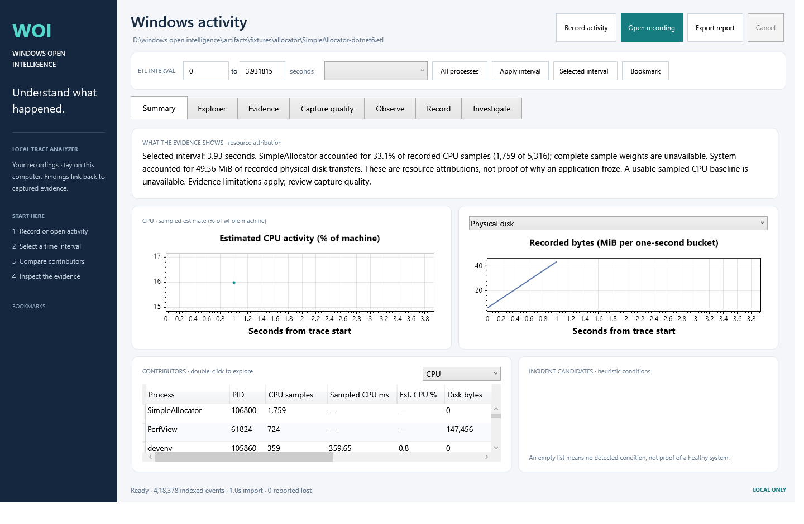
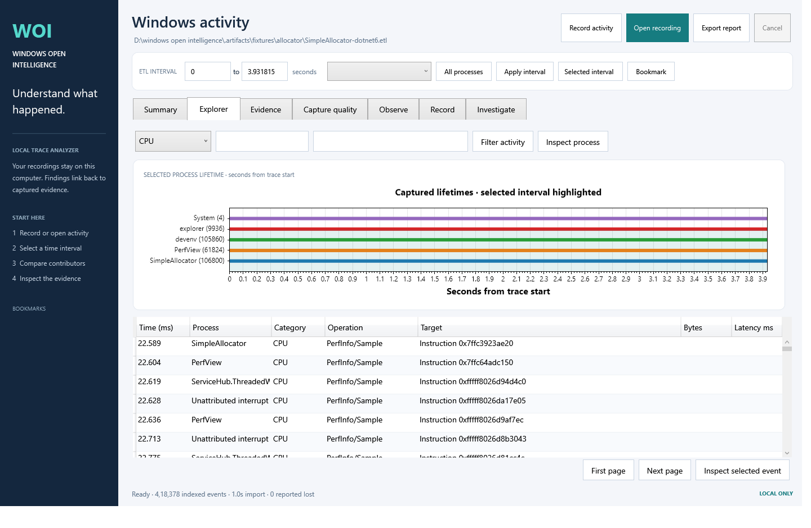
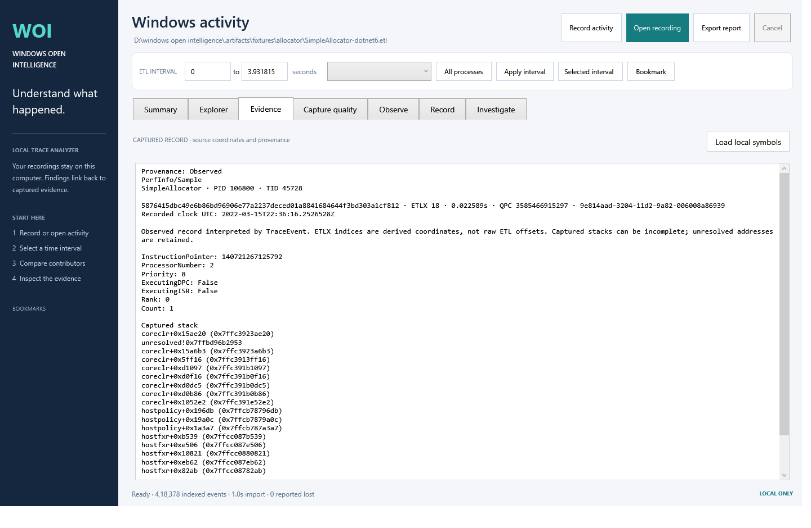

# Windows Open Intelligence

**Understand what Windows was doing when your PC slowed down.**

Windows Open Intelligence brings recorded activity, resource contributors, and supporting events into one local desktop app. Open a Windows trace, select the moment that matters, and follow each finding back to its evidence. You can also observe recent activity, save investigations, and compare equivalent attempts.

[Engineering preview](https://github.com/ard12/windows_open_intelligence_layer/releases) · [MIT license](LICENSE) · [Contributing](CONTRIBUTING.md)

## What you can investigate

| Start with a question | Explore the evidence |
|---|---|
| Which processes used resources during this interval? | CPU sample rankings, physical disk activity, captured file/network events and process lifetimes. |
| What changed between two attempts? | Saved investigations and comparisons with explicit measurement-compatibility checks. |
| What supports this finding? | Event details, attribution basis, captured stacks and trace-local evidence coordinates. |

Analysis runs locally, with no cloud account or upload required. Collection must already be running, or you need an existing ETL: the app cannot recover activity that was never recorded.

This is an **engineering preview**, open for use, inspection, and contribution. Existing functionality includes ETL analysis, bounded recent-history observation, saved investigations/comparisons, and guided WPR recording. Execution/dependency graphs and application-level causal diagnosis are not implemented. Windows 11 acceptance, the elevated helper's trust/storage review, and several performance gates remain open; this is not a stable, generally recommended executable release. See [current checkpoints](docs/checkpoints.md) and [verification](docs/validation.md).

The 13 October local Release build passed **115 tests with zero skips**, including long-path cache and investigation regressions. The earlier extracted desktop passed its analysis, recovery, observation and saved-investigation checks; packaged replay handled 228 requests and 50,000 paged events. Dependency identity/advisory checks and package privacy regressions passed. These local results do not close the native Windows 11, elevated storage or helper-trust gates; see [the release-remediation record](docs/verification/release-remediation-2026-10-13.md) and [current validation](docs/validation.md).

## See it working

These are genuine captures from the locally tested preview, using Microsoft's public `SimpleAllocator-dotnet6.etl` sample. They show recorded sample data, rather than measurements of your computer. [Screenshot provenance](docs/screenshots/README.md).

**Summary — choose an interval and compare the processes contributing recorded activity.**

**Explorer — connect activity to process lifetimes and browse individual events.**

**Evidence — inspect the recorded event, provenance and captured stack.**

## Run

Start with the [preview releases](https://github.com/ard12/windows_open_intelligence_layer/releases). Read each release's validation notes and asset list; a source-only preview requires the build instructions below. Previews are experimental and may be unsigned.

Extract **WindowsOpenIntelligence-win-x64.zip** into a local folder and open **WindowsOpenIntelligence.exe**. Keep the application, worker, recording helper, DLLs, and runtime files together. The package is self-contained; users do not need Visual Studio or the .NET SDK.

Windows 11 x64 is the release baseline. Local build and desktop tests ran on Windows 10 Pro build 19045 x64. Windows 11 acceptance is still pending.

### Investigate an existing recording

1. Choose **Open recording** and a local ETL.
2. Inspect resource charts; hold **Shift** and drag on the CPU chart, or enter seconds and apply the interval.
3. Compare contributors ranked by CPU, completed disk bytes, or summed recorded latency. Double-click a contributor to inspect its lifetime.
4. Filter the paged **Explorer**, then double-click an event to see captured **Evidence**.
5. Review **Capture quality**, adjust heuristic thresholds, bookmark intervals, and export Markdown or JSON.

### Observe a slowdown without elevation

1. Open **Observe** and choose **Start observing** before the activity you want to investigate. The app collects roughly one-second Windows API snapshots in a separate unprivileged worker.
2. When a slowdown occurs, choose **Mark slowdown**. Review accounted process CPU, available physical memory, process I/O accounting, current contributors, and the retained lifetime list.
3. Choose **Stop observing** when done. Unsaved history is in memory only and disappears when you stop or close the app. For event-level evidence, use a guided WPR recording or import an ETL.

The first sample is a counter baseline. Unreadable processes, missed ticks, clock changes, and counter resets remain visible as unavailable values or collection gaps. The ring allows up to 60 minutes but also caps process rows and estimated bytes; the displayed retained duration is the actual one.

### Investigate and compare recorded history

1. In **Observe**, start collection before reproducing the symptom. Mark the time it occurs, then open **Investigate**.
2. Choose the recent interval or marked time, describe the symptom, and optionally select an observed application lifetime. **Understand interval** shows up to three deterministic observations, their coverage/limits, and a next measurement. Double-click a contributor or inspect a finding to see its snapshot coordinates.
3. Create two investigations for equivalent attempts. Confirm the same task and the change you made before comparing. Duration and absolute resource use are shown together; incompatible measurements receive no calculated difference.
4. **Save evidence** writes a bounded local `.woi` investigation. Reopen saved files to compare separate sessions. Matching application path/version context requires explicit user confirmation; PID alone cannot match applications across sources.
5. **Attach selected ETL** preserves the selected imported trace report as a separate evidence source. Attachment does not imply clock alignment or a common cause. Export investigation/comparison reports after reviewing included names, machine metadata, notes, and references. Original ETL files and full snapshot records are excluded from report export.

Saved investigations contain recorded snapshot evidence and optional ETL report metadata, with a checksum for accidental damage detection. Findings are recalculated on reopen. This is not a tamper-proof evidence container. Local file limits are 128 MiB/container and 96 MiB/payload; pinned workspaces are bounded to eight investigations and 250,000 snapshot process rows. Close a pinned investigation to free its budget. Stopping observation discards its unsaved pinned investigations; saved files remain available.

### Record an investigation

1. Choose **Record activity**, then **Resources** or **File activity** and a duration from 5 to 120 seconds.
2. Select **Start recording** and approve Windows administrator elevation for the same Windows account. The UI and analyzer stay unprivileged.
3. Reproduce the activity. Choose **Stop and analyze**, wait for the deadline, or cancel to discard the active session.
4. A completed ETL is fingerprinted and imported automatically. Review its actual coverage, then use **Save recording copy** if you want another local copy.

Profiles request a fixed 128 MiB kernel buffer pool in WPR memory mode. Older buffers may be overwritten; the duration limit does not guarantee complete retained history. Collector files now use a protected `WindowsOpenIntelligence.Collector\<Windows SID>` directory at the root of the application's fixed local NTFS volume: installing on D: keeps this collector storage on D:. Completed recordings are read-only to the signed-in user; **Save recording copy** creates a user-owned copy. Analyzer caches remain under `%LOCALAPPDATA%\WindowsOpenIntelligence\cache`. Recording requires at least 2 GiB free space at start; a save can still run out of space. WPR receives protected temporary-directory paths, but service-side temporary writes have not been measured.

The helper owns a unique WPR instance and cancels only that instance. Existing tracing tools can still cause provider conflicts; a failed start is reported explicitly. No global WPR cancel or automatic takeover is used. Reopening recording controls attempts recovery of interrupted, verifiably owned sessions in protected storage. Legacy user-writable recording folders are preserved and excluded from privileged recovery. Native capture acceptance must be repeated after this storage change; earlier server checks do not validate the new paths or permissions.

## Evidence and limits

The original ETL is read-only and SHA-256 fingerprinted. Reopening verifies fingerprints of ETLX, import metadata, and aggregate SQLite. Bookmarks are stored separately. Reports exclude the original ETL, but can contain paths, command lines, endpoints, and addresses; review them before sharing.

- Import limits: 1 GiB source, five million indexed events, 2 GiB combined derived files. Exceeding a limit fails explicitly. Maximum-size ETL decoding is not certified.
- Supported observations: process/thread lifetimes, modules, sampled CPU, physical disk transfers and recorded latency, logical file operations, TCP/IP or UDP, process working-set snapshots, and hard faults when captured.
- Unavailable measurements stay nullable. Provider requests and zero reported loss do not establish complete capture.
- CPU estimates use recorded sampling intervals and processor count. Rankings use sample weights when all contributing samples have known weights; otherwise they use counts. Native TraceProcessing comparisons on three public fixtures meet the unchanged 1% weight-agreement gate; wider WPA, recording-schema, and desktop-OS validation remains open.
- Physical disk bytes, logical file bytes, and network event bytes are separate measurements. Summed latency can overlap; it is not elapsed disk busy time.
- ETLX indices are derived coordinates, not original ETL byte offsets. Lifetime identities govern PID/TID joins; ambiguous attribution remains unattributed.
- Incident candidates are configurable heuristics, not diagnoses. Descriptions classify observations, resource attribution, and temporal correlation.
- Symbols load only from a local directory on request. No cloud analysis, HTTP service, online symbols, automatic startup, Windows service, custom driver, or automatic remediation is included.

## Build and verify

Use x64 Windows and .NET SDK **10.0.401**, pinned in global.json. NuGet versions are locked. You can install the SDK normally or use the local setup script:

~~~powershell
.\scripts\setup-sdk.ps1
.\scripts\build.ps1
$env:DOTNET_ROOT = (Resolve-Path .\.tools\dotnet).Path # local SDK development apphost
.\src\Woi.Desktop\bin\Debug\net10.0-windows\WindowsOpenIntelligence.exe
~~~

~~~powershell
.\scripts\test.ps1 -DownloadFixtures
.\scripts\publish.ps1
.\scripts\export-source.ps1
~~~

SDK, package, and public fixture downloads use the network during development. Product analysis remains local. Node.js is needed only for the developer replay stress script. See [reproduction commands](docs/validation.md).

Packaging requires PowerShell 7 and now verifies locked package hashes, shipped dependency bytes, current NuGet advisories and the bundled runtime patch before publishing the ZIP. It fails if verification cannot complete. With an existing locked restore, `publish.ps1 -NoRestore` prevents dependency downloads; advisory JSON still requires network access. [Dependency scope and native maintenance limits](docs/verification/dependencies-2026-10-13.md).

The [Windows GitHub workflow](.github/workflows/windows.yml) builds locked dependencies, tests real ETLs, runs native controlled recordings, checks report export and desktop recovery, and stresses the packaged worker before uploading artifacts. The latest recorded successful [Windows Server run](https://github.com/ard12/win_OiL/actions/runs/36881591865) passed these functional checks on source 1fdbe28. A later run for 12e6447 never started and executed zero steps, so it supplies no current-source remote validation. Server results do not establish Windows 11 compatibility or passing every performance budget.

The generated **WindowsOpenIntelligence-source.zip** contains source, dependency locks, workflow, docs, and notices. Source and application packagers share exclusions for saved investigations, interrupted saves, memory dumps, traces, databases and sidecars, credentials, keys, developer PDBs, SDKs, binaries, and local test artifacts. Docs and licenses must be tracked or explicitly required as reviewed public documents when Git metadata is present; source export also retains new nonignored code/build files. Both refuse redirected paths. Review added reports before sharing: permitted Markdown and JSON can still contain private evidence. The source is suitable for an experimental public repository; executable distribution remains an engineering preview subject to the open verification gates.

The worker also has a diagnostic CLI:

~~~powershell
.\dist\WindowsOpenIntelligence\Woi.Worker.exe --analyze "D:\traces\recording.etl" --output "D:\reports\incident.json"
~~~

See [the product reassessment](docs/product-reassessment.md), [the engineering timeline](docs/engineering-plan.md), [architecture](docs/architecture.md), [capture design](docs/capture.md), [protocol](docs/protocol.md), [roadmap](docs/roadmap.md), and [contributing](CONTRIBUTING.md). Project code is MIT licensed; dependency notices are in [THIRD-PARTY-NOTICES.md](THIRD-PARTY-NOTICES.md) and licenses/.

The next-five-checkpoint status is recorded in [checkpoints](docs/checkpoints.md). The P3 [experiment protocol](docs/experiment.md) and empty results ledger distinguish preparation from participant evidence.

## About the maintainer

Created and maintained by [ard12](https://github.com/ard12). This project aims to make Windows performance investigations easier to follow: start with a symptom, narrow the interval, and inspect the evidence behind each finding. Contributions that improve clarity, correctness and reproducible Windows validation are welcome.
